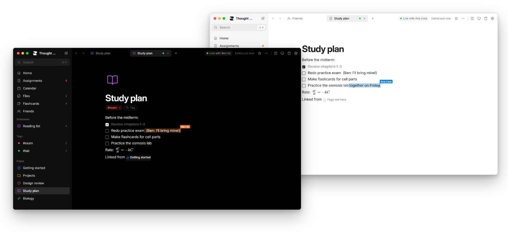
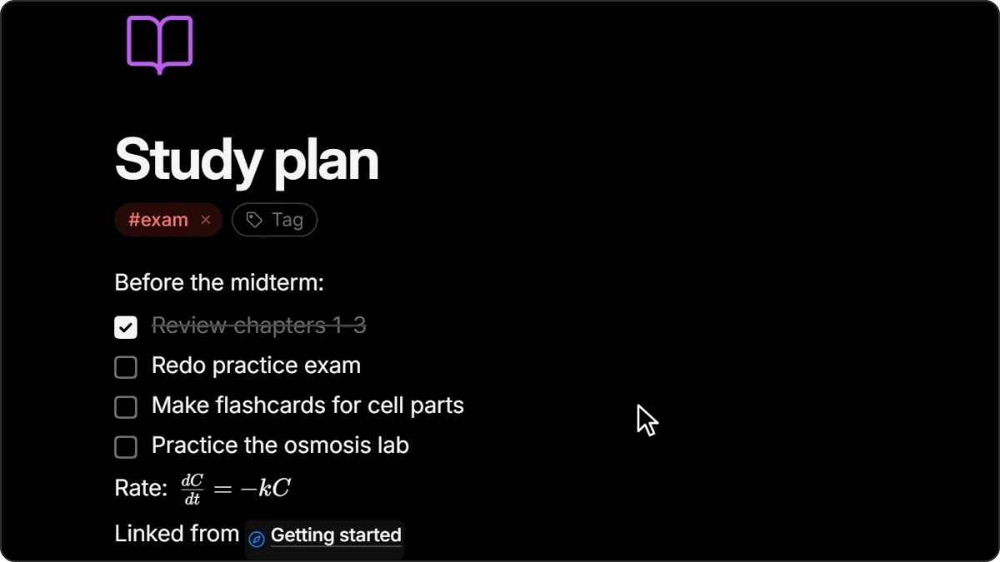
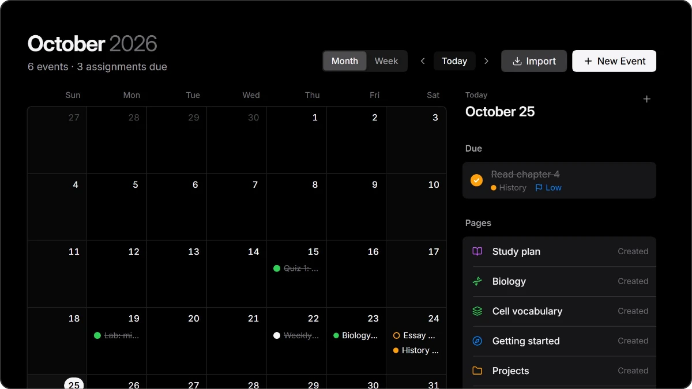
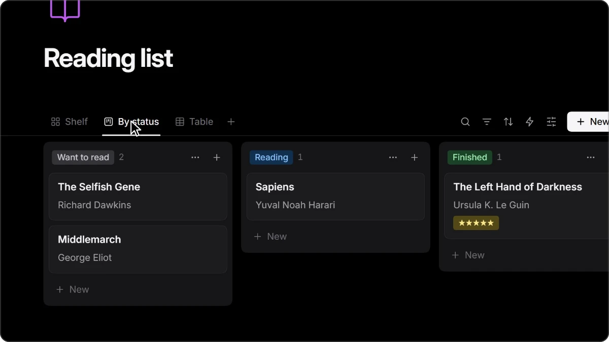
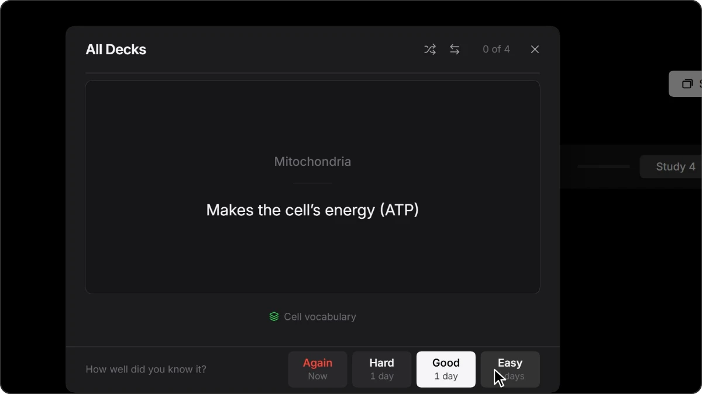
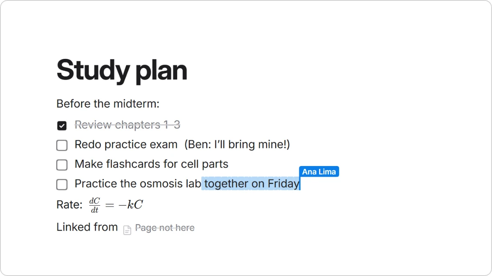

<div align="center">


# Thought Desk

**Write, plan and study in one quiet place.**

A free, local-first notes app for students: pages, assignments, a calendar,<br>
flashcards and databases, all linked together. Bring a friend onto a page when you want one.

[](https://github.com/kusule1351-hue/thought-desk/releases/latest)
[](https://github.com/kusule1351-hue/thought-desk/releases)
[](LICENSE)
[](https://discord.gg/JEaUHwz5bP)

[**Download for Windows**](https://thoughtdesk.org/download/windows) &nbsp;·&nbsp; [**Mac**](https://thoughtdesk.org/download/mac) &nbsp;·&nbsp; [**Linux**](https://thoughtdesk.org/download/linux) &nbsp;·&nbsp; [thoughtdesk.org](https://thoughtdesk.org)

<br>



</div>

<br>

## Everything in one place

<table>
<tr>
<td width="50%" valign="top">

<h3>Write</h3>
Pages inside pages, a block editor with <code>/</code> commands and Markdown shortcuts, and math you type as LaTeX: <code>$\frac{dC}{dt}$</code> becomes a real formula.
</td>
<td width="50%" valign="top">

<h3>Plan</h3>
Assignments sorted by when they're due, and a calendar of your classes and deadlines. Import your schedule from Canvas, Google Calendar or Outlook.
</td>
</tr>
<tr>
<td width="50%" valign="top">

<h3>Organize</h3>
Databases you can see as a table, board, gallery, list, calendar, chart, timeline or form, with formulas, relations and automations.
</td>
<td width="50%" valign="top">

<h3>Remember</h3>
Write flashcards right in your notes. Spaced repetition brings each card back just before you'd forget it.
</td>
</tr>
<tr>
<td width="50%" valign="top">

<h3>Together</h3>
Invite a friend to a page and write at the same time, with each other's cursors and names. Only that page is shared, and you both keep it afterwards.
</td>
<td width="50%" valign="top">
<h3>And the rest</h3>

- Tabs and split view
- Search everything with <kbd>Ctrl</kbd> <kbd>K</kbd>
- Quick Capture from anywhere
- Course pages, grades and lecture notes in one click
- Reminders before things are due
- Light, dark and color themes
- Export to Word and Markdown (and PDF on Windows)
- Every shortcut can be changed

**[See every feature →](docs/FEATURES.md)**
</td>
</tr>
</table>

## Yours, on your computer

- **Your notes stay on your computer.** Everything lives in one file on your disk and works offline. Nothing leaves it unless you write a page together with a friend, and the relay that carries that writing keeps none of it.
- **No account needed.** Signing in is optional, and only for friends and writing together. Even then, only your profile, your friends and your invites are online.
- **Take it with you.** Export every page to Markdown (it opens as an Obsidian vault) and every database to CSV, whenever you like.
- **Open source.** Every line is here to read, under the [AGPL-3.0](LICENSE).

## Small and fast

| | Thought Desk | A typical Electron notes app |
|---|---|---|
| Download | **about 4 MB** | 80–200 MB |
| Memory while open | **about 115 MB** | 300–600 MB |

Built with Rust, Tauri and Svelte on the web view your system already has, instead of shipping its own copy of Chrome. It's tested against workspaces of 7,500 pages and databases of 50,000 rows. [How it stays fast →](docs/PERFORMANCE.md)

## Download

| System | Get it |
|---|---|
| **Windows 10 and 11** | [Installer](https://thoughtdesk.org/download/windows), about 4 MB. It isn't code-signed yet, so Windows may show "Windows protected your PC": click **More info**, then **Run anyway**. Signing through [SignPath](https://thoughtdesk.org/code-signing) is on its way, and so is a Microsoft Store version. |
| **macOS** | [Disk image](https://thoughtdesk.org/download/mac) for Apple silicon and Intel, signed and notarized by Apple. |
| **Linux** | [AppImage](https://thoughtdesk.org/download/linux), or the [.deb](https://thoughtdesk.org/download/linux-deb) for Ubuntu and Debian. |

Thought Desk updates itself: it checks for a new version when it starts, and installs it in one click. Every version is on the [releases page](https://github.com/kusule1351-hue/thought-desk/releases).

## Build from source

You need Node 20+ and stable Rust (on Windows, the MSVC toolchain).

```bash
git clone https://github.com/kusule1351-hue/thought-desk.git
cd thought-desk
npm install
npm run app     # the desktop app, with hot reload
```

Tests, where your notes are stored and how the code is laid out: [docs/DEVELOPMENT.md](docs/DEVELOPMENT.md).

## Contributors

<table>
<tr>
<td align="center" width="140"><a href="https://github.com/kusule1351-hue"><br><b>Khuselbayar Enkhmunkh</b></a><br><sub>Creator</sub></td>
<td align="center" width="140"><a href="https://github.com/brandonrbridges"><br><b>Brandon Bridges</b></a><br><sub>Search, indexes and speed</sub></td>
<td align="center" width="140"><a href="https://github.com/huy-victor"><br><b>Victor Huy</b></a><br><sub>Frozen table columns</sub></td>
<td align="center" width="140"><a href="https://github.com/Kewsito"><br><b>Kevin Salinas</b></a><br><sub>Spanish translation</sub></td>
</tr>
</table>

Thank you to everyone who has [contributed](https://github.com/kusule1351-hue/thought-desk/graphs/contributors).

## Contributing

Fixes, measurements and ideas are welcome. Start with [CONTRIBUTING.md](CONTRIBUTING.md); contributors sign a short [Contributor License Agreement](CLA.md) once, on their first pull request. Questions, or just want to talk? Join the [Discord](https://discord.gg/JEaUHwz5bP).

**Want Thought Desk in your language?** Translations are JSON files, one per area of the app, and can be done a bit at a time: [docs/TRANSLATING.md](docs/TRANSLATING.md) shows how.

## License

Copyright (C) 2026 Kusule. Thought Desk is free software under the [GNU Affero General Public License](LICENSE), version 3 or later: if you distribute a modified version, or let people use one over a network, you must share its source under the same license.

The license covers the code, not the Thought Desk name or logo: forks and redistributed versions need their own name and logo. The interface uses [Inter](https://rsms.me/inter/) by Rasmus Andersson, under the SIL Open Font License 1.1.
